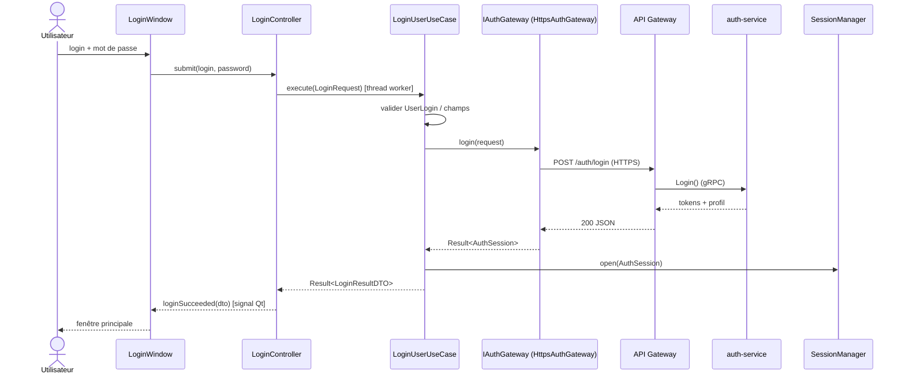

# FEATURE LOGIN / AUTHENTIFICATION — Analyse et conception

> SECURECLOUD[SKELETON] · Client Qt · rédigé le vendredi 30 octobre 2026
> Statut : **proposition à valider** · mis à jour le 30/10/2026 (soir) après réception de `domain.zip` ; couche Application déjà codée et testée (voir §12)
> Source : `UseCases.md` (UC-01), `Architecture-Client.md`, `specifications-securecloud-skeleton.md` (F3.1, F3.2, F3.5, ARC-01)

**Objectif** : l'utilisateur saisit identifiant et mot de passe, le Client les envoie en HTTPS à l'API Gateway,
qui les relaie à `auth-service` par gRPC. La réponse remonte jusqu'à l'UI. **Test E2E visé : vendredi 6/11/2026.**

---

## 1. Périmètre

| Dans la tranche | Hors tranche (voir `Roadmap.md`) |
|---|---|
| UC-01 scénario nominal | MFA (champ réservé dans le contrat) |
| Échecs : identifiants invalides, compte refusé, serveur inaccessible, réponse invalide, trop de tentatives | Récupération identifiant / mot de passe |
| Session en mémoire (`SessionManager`) | Persistance du refresh token, refresh automatique |
| UC-09 Logout **côté Client seulement** (oublier la session) | Révocation côté serveur (`/auth/revoke`) |
| Écran `LoginWindow` | Écran principal, messagerie, alertes |

---

## 2. État de l'existant (constat sur `repository.zip`)

Le zip ne contient que **4 headers** : `IUserRepository.h`, `IConversationRepository.h`, `IMessageRepository.h`, `RepositoryError.h`.
Il n'y a ni `domain/model/`, ni `shared/`, ni CMake, ni code de test.

**Bon à garder**
- Politique cohérente : « introuvable » = `std::optional` ou `nullptr`, panne technique = `RepositoryError`. C'est lisible et simple.
- `unique_ptr<Conversation>` pour le type abstrait, `[[nodiscard]]`, méthodes `const` : bons réflexes.
- `findByStatus(MessageStatus)` sert d'outbox et évite une file séparée.

**Login n'utilise aucun de ces repositories.** Le profil de l'utilisateur connecté vit dans la session en mémoire, et `IUserRepository::save` est de toute façon reporté. La feature ne dépend donc pas de ce dossier, à une condition : ne pas lier `IMessageRepository.h` à la cible Login tant qu'il est cassé.

**`IMessageRepository.h` : défauts bloquants**

| # | Problème | Correctif proposé |
|---|---|---|
| 1 | Une classe `IMessageRepository` vide est définie, puis redéfinie juste après → erreur de redéfinition | Supprimer le premier bloc vide |
| 2 | `Result<…>` utilisé sans `#include` : `shared/Result.h` n'existe pas encore | Supprimer les 4 méthodes concernées (voir 4) |
| 3 | `DeliveryStatus` n'existe pas : le fichier inclut `Enums.h // MessageStatus` | Utiliser `MessageStatus` |
| 4 | Doublons avec les méthodes déjà présentes : `history` ≈ `findBefore`, `findPendingOutgoing` ≈ `findByStatus(BUFFERED)`, `updateDeliveryStatus` ≈ `save` (upsert) | Supprimer `history`, `findPendingOutgoing`, `updateDeliveryStatus` ; garder `exists` sous la forme `[[nodiscard]] virtual bool exists(const MessageId&) const = 0;` (dédoublonnage UC-06) |
| 5 | Le commentaire `/* A revoir : … ConversationId */` reste ouvert | À trancher avec UC-02 |

Ces corrections ne sont **pas** dans le chemin critique de Login ; elles sont notées dans `Roadmap.md` §4.

**Domaine reçu (`domain.zip`)** : compilé avec g++ 13, `-std=c++20 -Wall -Wextra -Wpedantic` : **57 tests verts, 3 familles de warnings** (détail dans `DomainReview.md`). Ce qui sert à Login et existe déjà : `UserId`, `UserLogin`, `UserRole` (`ADMIN`, `COORD`, `STD_USER`), `User`, `TimeStamp`. **Je n'ajoute donc ni `Role` ni `Session` au domaine** : `UserRole` existe, et le `SessionManager` de la couche Application suffit pour la tranche (l'entité `Session` du domaine passe en Roadmap).

Trois points du domaine touchent directement Login :
1. `UserLogin` **supprime tous les espaces**, y compris au milieu (`"al ice"` devient `"alice"`), alors que son en-tête dit « trim ». Votre test le documente comme « à décider ». Pour un login c'est sensible : une faute de frappe change silencieusement l'identité envoyée. Recommandation : ne retirer que les espaces de début et de fin, et rejeter le reste.
2. `User` exige `createdAt` à la construction, alors que le serveur ne l'envoie pas dans le contrat v0 (§6). Je propose d'ajouter `created_at` (optionnel) au contrat ; à défaut, le mapper utilisera l'instant de connexion.
3. Le serveur doit **normaliser le login de la même façon** (minuscules) : le Client envoie la forme normalisée, mais il ne faut pas que la Gateway en dépende pour la sécurité.

---

## 3. Scénario

| Étape | Acteur | Action |
|---|---|---|
| 1 | Utilisateur | Saisit identifiant + mot de passe dans `LoginWindow`, valide |
| 2 | UI | Contrôles de forme (champs non vides, `UserLogin` valide) puis appel du contrôleur ; bouton désactivé, indicateur d'attente |
| 3 | Application | `LoginUserUseCase::execute` appelle le port `IAuthGateway::login` |
| 4 | Infrastructure | `POST /auth/login` en HTTPS vers la Gateway |
| 5 | Gateway → `auth-service` | Validation, vérification du hash, émission des tokens |
| 6 | Infrastructure | Parse la réponse, la convertit en `AuthSession` applicatif |
| 7 | Application | `SessionManager` mémorise tokens + profil ; renvoie un `LoginResultDTO` |
| 8 | UI | Ouvre la fenêtre principale |

**Échecs, et ce que l'UI en fait**

| Cas (UC-01) | Code d'erreur applicatif | Message UI |
|---|---|---|
| Champ vide / identifiant mal formé | `InvalidInput` (aucun appel réseau) | « Identifiant ou mot de passe manquant » |
| Identifiants incorrects | `InvalidCredentials` | « Identifiant ou mot de passe incorrect » |
| Compte non autorisé | `AccountDisabled` | « Compte désactivé, contactez votre administrateur » |
| Trop de tentatives | `RateLimited` (+ délai si fourni) | « Réessayez dans N secondes » |
| Réseau indisponible, TLS refusé, timeout | `ServerUnreachable` | « Serveur inaccessible » |
| Gateway joignable, `auth-service` en panne | `ServiceUnavailable` | « Service momentanément indisponible » |
| Réponse illisible ou rôle inconnu | `InvalidResponse` | « Réponse inattendue du serveur » |

Règle de sécurité : « identifiant inconnu » et « mot de passe faux » donnent **le même code** (`InvalidCredentials`), sinon on permet l'énumération des comptes.

---

## 4. Séquence



Variante d'échec : `GW` renvoie `Result` en erreur (`InvalidCredentials`, etc.), le use case la propage, le contrôleur émet `loginFailed(code)`, l'UI affiche le message du tableau §3.

---

## 5. Modélisation sommaire

| Couche | Élément | Rôle |
|---|---|---|
| Domain | `UserLogin` (existant) | VO d'identifiant normalisé |
| Domain | `User`, `UserId` (existants) | Profil de l'utilisateur connecté |
| Domain | `UserRole` (existant, `Enums.h` : `ADMIN`, `COORD`, `STD_USER`) | Rôle porté par `User` ; **usage UI seulement** |
| Shared | `Result<T, E>`, `secureWipe` / `ScopedWipe` | Retour des échecs attendus ; effacement des secrets en mémoire |
| Application | `LoginRequest` | `UserLogin` + mot de passe (`std::string`, effacé après usage) |
| Application | `IAuthGateway` (port) | `Result<AuthSession, AuthFailure> login(const LoginRequest&)` |
| Application | `AuthSession` | `AccessToken`, `RefreshToken`, `expiresAt`, `User` |
| Application | `AuthError`, `AuthFailure` | Enum des codes du §3 + délai de relance éventuel |
| Application | `LoginUserUseCase` | Valide, appelle le port, ouvre la session |
| Application | `SessionManager` | Détient `Session` + tokens + utilisateur courant ; `isAuthenticated()`, `close()` |
| Application | `LoginResultDTO` | Ce que l'UI reçoit (`login`, `UserRole`), jamais de token |
| Infrastructure | `AuthJsonMapper` | JSON ↔ objets applicatifs, **sans réseau** (testable seul) |
| Infrastructure | `HttpsAuthGateway` | Implémente `IAuthGateway` avec Qt Network |
| UI | `LoginController` (QObject) | Lance le use case sur un thread worker, émet `loginSucceeded` / `loginFailed` |
| UI | `LoginWindow` | Saisie, état d'attente, message d'erreur |

Esquisse du port et du use case (contrat, pas encore du code livré) :

```cpp
// application/IAuthGateway.h
class IAuthGateway {
public:
    virtual ~IAuthGateway() = default;
    [[nodiscard]] virtual AuthResult login(const LoginRequest&) = 0;   // Result<AuthSession, AuthFailure>
};

// application/LoginUserUseCase.h
class LoginUserUseCase {
public:
    LoginUserUseCase(IAuthGateway&, SessionManager&);
    [[nodiscard]] LoginOutcome execute(const std::string& rawLogin, std::string password);
};
```

Pourquoi un port `IAuthGateway` plutôt que `ITransport` générique : `ITransport` conviendra au WebSocket de messagerie, mais un login a un contrat précis (entrées, erreurs typées). Un port étroit se simule en trois lignes dans les tests. `ITransport` reste réservé à la messagerie.

---

## 6. Contrat v0 Client ↔ API Gateway — **[À NÉGOCIER avec l'équipe Gateway / auth]**

C'est le point critique de la semaine : sans contrat figé lundi, le E2E du vendredi est en danger.

> **Version détaillée et à jour : `ContratGateway-Auth.md`** (logique TCP/TLS/HTTP, tableaux d'erreurs, comptes de test). En cas de différence, ce fichier fait foi. Changement notable : le délai de relance passe dans l'en-tête HTTP standard `Retry-After`, plus dans le corps.

**Requête**

```
POST https://<gateway>/auth/login
Content-Type: application/json

{ "login": "alice", "password": "…", "mfa_code": null }
```

**Succès : `200`**

```json
{
  "access_token": "…",
  "refresh_token": "…",
  "token_type": "Bearer",
  "expires_in": 900,
  "user": { "id": "u-123", "login": "alice", "role": "COORD", "created_at": "2026-10-01T08:00:00Z" }
}
```

Valeurs de `role` alignées sur `UserRole` : `ADMIN`, `COORD`, `STD_USER`. `created_at` est optionnel (ISO 8601 UTC). La clé publique de chiffrement n'est **pas** dans le contrat v0 : la gestion de clés relève de `Crypto.md`, qui n'existe pas encore.

**Erreurs : corps `{ "error": { "code": "…", "message": "…" } }`**

| HTTP | `code` | Remarque |
|---|---|---|
| 400 | `MALFORMED_REQUEST` | |
| 401 | `INVALID_CREDENTIALS` | Identifiant inconnu et mot de passe faux **indistinguables** |
| 401 | `MFA_REQUIRED` | Réservé, inutilisé en v0 |
| 403 | `ACCOUNT_DISABLED` | |
| 429 | `RATE_LIMITED` | En-tête `Retry-After` (secondes) |
| 503 | `SERVICE_UNAVAILABLE` | Gateway OK, `auth-service` injoignable |

Questions à poser à l'équipe Gateway :
1. Noms exacts des champs JSON (snake_case proposé).
2. Durée de vie de l'access token en démo.
3. Un utilisateur de test préchargé (identifiant, mot de passe, rôle) dans l'environnement `docker compose` pour le E2E.
4. Certificat TLS de dev : quelle autorité, et où récupérer son certificat racine ?
5. Mesure anti-force-brute : `429` retourné ou simple délai ?

---

## 7. Sécurité de la tranche

- **TLS obligatoire**, jamais de désactivation de la vérification des certificats, même en dev. En dev : une autorité de certification maison, dont le certificat racine est ajouté à la configuration SSL de `HttpsAuthGateway` (ou installé sur le poste). Si le client accepte « n'importe quel certificat », le login n'est plus sécurisé.
- **Mot de passe** : transite uniquement dans `LoginRequest`, jamais écrit dans un log ni dans le disque, effacé (`std::fill` sur le buffer) dès la réponse reçue. Aucun hash côté client : le hachage (argon2/bcrypt, F3.1) est l'affaire du serveur.
- **Tokens** : en mémoire seulement (`SessionManager`), jamais dans un log. La persistance chiffrée (CLIENT-03) est reportée.
- **Rôle côté Client = confort d'affichage**, pas un contrôle de sécurité. Un rôle inconnu reçu du serveur est une erreur `InvalidResponse`, pas un `USER` par défaut.
- **Logs** : jamais le corps de la requête. On peut loguer le code de statut et le code d'erreur.

---

## 8. Décisions proposées (à valider)

| ID | Décision | Raison |
|---|---|---|
| **D-L1** | **DOM-07 amendé** : les repositories lèvent `RepositoryError` pour les pannes techniques (choix déjà fait dans le dépôt, on le garde). Les use cases et ports réseau renvoient `Result<T>`, car « mauvais mot de passe » est un résultat attendu, pas une exception | Deux situations différentes, deux mécanismes, règle simple à énoncer |
| **D-L2** | Port dédié `IAuthGateway` | Voir §5 |
| **D-L3** | Use case **synchrone**, exécuté sur un thread worker par `LoginController` (`QtConcurrent::run` + `QFutureWatcher`). `HttpsAuthGateway` utilise `QNetworkAccessManager` créé dans ce thread, avec une `QEventLoop` locale et un timeout | Garde Application sans Qt et testable avec un simple mock ; l'UI ne se bloque jamais |
| **D-L4** | JSON via `QJsonDocument` dans `AuthJsonMapper` | Pas de dépendance supplémentaire ; le mapper reste testable sans réseau |
| **D-L5** | Un **faux Gateway** (petit serveur HTTPS de test dans `tests/tools/`) implémente le contrat v0 | Le Client avance sans attendre le serveur ; il sert aussi de test de contrat |
| **D-L6** | Tokens en mémoire seulement en v0 | Réduit la surface de risque, la persistance est en RM |
| **D-L8** | `UserLogin` : on ne retire que les espaces de début et de fin ; un espace interne est une erreur (décidé le 31/10) | Évite qu'une faute de frappe change l'identité envoyée |
| **D-L9** | `DirectConversation` : un utilisateur peut s'écrire à lui-même (« notes personnelles ») ; `p1 == p2` est autorisé (décidé le 31/10) | Cas d'usage voulu ; le test de rejet est remplacé par un test d'acceptation |
| **D-L7** | **On garde votre harnais de tests maison** (`CHECK`, `CHECK_THROWS`, `RUN_TEST`, rapport texte) au lieu de GoogleTest/GoogleMock. Les mocks sont des fakes écrits à la main | Zéro dépendance, déjà en place, déjà branché sur CTest ; GoogleTest reste possible plus tard. Remplace la proposition du sprint 0 |

---

## 9. Stratégie de tests

| Niveau | Cible | Outils | Cas principaux |
|---|---|---|---|
| Domain | `UserLogin`, `User` | Harnais maison (existant) | Déjà couverts (57 tests) ; à ajouter : décision sur les espaces internes |
| Application | `LoginUserUseCase`, `SessionManager` | Harnais maison + fake `IAuthGateway` (**fait**, 19 tests) | Succès ouvre la session ; chaque `AuthError` est propagée ; champ vide ⇒ **aucun appel** au port ; mot de passe effacé ; échec ⇒ session non ouverte |
| Infrastructure (mapper) | `AuthJsonMapper` | Harnais maison | Succès complet ; champ manquant ; rôle inconnu ⇒ `InvalidResponse` ; corps d'erreur de chaque code |
| Infrastructure (réseau) | `HttpsAuthGateway` + faux Gateway | Harnais maison + faux serveur HTTPS | 200, 401, 403, 429, 503 ; serveur éteint ⇒ `ServerUnreachable` ; timeout ; certificat non reconnu ⇒ refus |
| **E2E** | Client sans UI (exécutable de test) + vraie Gateway + `auth-service` (`docker compose up`) | CTest, script de lancement | voir ci-dessous |
| UI | `LoginWindow` | Test manuel, checklist | Bouton désactivé pendant l'appel, messages d'erreur, champ mot de passe masqué |

**Définition du E2E (critères d'acceptation)**

| ID | Scénario | Résultat attendu |
|---|---|---|
| E2E-LOGIN-01 | Bon identifiant, bon mot de passe (utilisateur préchargé) | Session ouverte, tokens non vides, rôle conforme |
| E2E-LOGIN-02 | Mauvais mot de passe | `InvalidCredentials`, aucune session |
| E2E-LOGIN-03 | `auth-service` arrêté, Gateway active | `ServiceUnavailable` |
| E2E-LOGIN-04 | Gateway arrêtée | `ServerUnreachable` dans le délai de timeout |
| E2E-LOGIN-05 | Identifiant inconnu | **Même** code que E2E-LOGIN-02 |

---

## 10. Plan de la semaine

| Jour | Travail | Livrable vérifiable |
|---|---|---|
| **Ven 30/10** | Valider ce document ; envoyer le contrat §6 à l'équipe Gateway ; me transmettre `domain/model/` et `shared/` | Contrat envoyé, décisions D-L1…D-L6 tranchées |
| **Lun 2/11** | Contrat figé. Relecture du code livré le 30/10 (§12), CMake + `ctest` sur votre poste, décisions sur `UserLogin` | `ctest` vert chez vous |
| **Mar 3/11** | ~~Application~~ **faite en avance** (§12). Reste : `AuthJsonMapper` (JSON ↔ objets) et ses tests, démarrage du faux Gateway | Tests mapper verts |
| **Mer 4/11** | `HttpsAuthGateway`, faux Gateway HTTPS avec certificat de dev | Tests réseau verts |
| **Jeu 5/11** | `LoginController` + `LoginWindow`, câblage dans `main.cpp`, essai manuel contre le faux Gateway ; premier essai contre la vraie Gateway | Login manuel réussi |
| **Ven 6/11** | Exécution E2E-LOGIN-01 à 05 contre la vraie pile ; correction ; mise à jour de la traçabilité (spec F3.1/F3.2, UC-01) | **E2E vert**, ou liste précise des écarts |

**Risques**
1. **Dépendance à l'équipe Gateway** : si la vraie pile n'est pas prête vendredi, le E2E tourne contre le faux Gateway et on le dit clairement (le faux Gateway valide le contrat, pas le serveur).
2. **TLS en dev** : prévoir une demi-journée, c'est le piège classique.
3. **Qt Network sur thread worker** : un `QNetworkAccessManager` doit vivre dans le thread qui l'utilise. D-L3 l'impose.
4. **Semaine courte** : si tout glisse, sacrifier d'abord `LoginWindow` (le E2E sans UI reste valable), jamais les tests de la couche Application.

---

## 11. Traçabilité

| Élément | Spec / ADR | Statut |
|---|---|---|
| `POST /auth/login` côté Client | F3.1, ARC-01 | SK |
| Tokens courts + refresh | F3.2, AUTH-01 | SK (refresh reporté) |
| MFA | AUTH-02 | RM pour la tranche (champ réservé) |
| Pas de crypto maison, TLS vérifié | SEC-02, AUTH-02 | SK |
| Rôle côté Client = UI seulement | `Architecture-Client.md` §2 | Rappel |
| Logout local | UC-09 | SK (sans révocation serveur) |

---

## 12. Livré le 30/10/2026 (soir) : couche Application

Fichiers ajoutés (aucun fichier de votre domaine n'est modifié) :

```
src/shared/Result.h            src/application/AuthError.h        src/application/LoginUserUseCase.h/.cpp
src/shared/SecureWipe.h        src/application/LoginRequest.h     src/application/SessionManager.h/.cpp
tests/application_test_1.cpp   src/application/AuthSession.h      src/application/LoginResultDTO.h
CMakeLists.txt (version proposée, 1 bloc ajouté : sc_application + run_application_tests)
                               src/application/IAuthGateway.h
```

Vérifié : compilation g++ 13 `-std=c++20 -Wall -Wextra -Wpedantic`, **19 tests / 80 checks verts**, aussi sous AddressSanitizer + UBSan. Les seuls warnings viennent de `User.h` (ordre d'initialisation).
**Non vérifié** : le `CMakeLists.txt` (CMake n'est pas installé dans mon environnement) ; Qt ; Windows/MSVC. À lancer chez vous : `cmake -S . -B build -DSC_BUILD_UI=OFF && cmake --build build && ctest --test-dir build --output-on-failure`.

Comportements couverts par les tests : succès ouvre la session ; login normalisé avant envoi ; login vide ou mal formé et mot de passe vide ⇒ `INVALID_INPUT` **sans appel réseau** ; chacune des six erreurs serveur est propagée sans ouvrir de session ; `RATE_LIMITED` garde son délai ; un échec ne ferme pas une session déjà ouverte ; le mot de passe est effacé en mémoire (`ScopedWipe`).

Limite connue : l'effacement mémoire est « au mieux » (copies internes de `std::string`, swap système).
