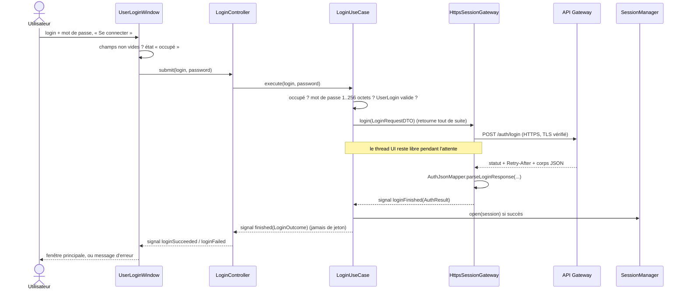
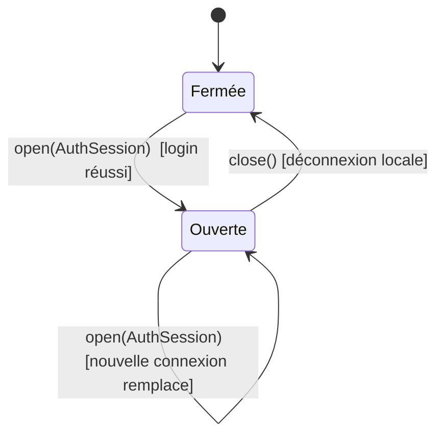

# UC1 — Se connecter : guide de conception

> SECURECLOUD[SKELETON] · Client Qt · **v0.3 du 26/11/2026** · référence de conception pour UC1 (remplace la v0.2 du 09/11).
> Décisions : `ADR_UC1_Login_Client.md` (v3). Diagrammes : `UC1_UML.md`. Règles : `Règles de conception.md` (v2). Protocole : `Contrat_auth_Client-Gateway-Service.md` (**v0.1**, fait foi pour tout ce qui passe sur le fil).
>
> **Les extraits de code sont des esquisses de conception, non compilées** (Qt n'est pas installé dans l'environnement de Claude). Ils seront compilés et corrigés chez l'équipe à l'implémentation.

Chaque brique est présentée ainsi : *à quoi elle sert*, *comment elle est faite*, *ce qu'il faut maîtriser*.

---

## 1. UC1 en une page

Un utilisateur saisit identifiant et mot de passe. Le Client les envoie en HTTPS à l'API Gateway, qui interroge `auth-service` (gRPC). La réponse remonte : soit une **session** (jetons + profil), soit une **erreur typée** que l'UI traduit en message.

| Dans la tranche | Hors tranche (Roadmap) |
|---|---|
| Scénario nominal et 7 familles d'échec (§8) | MFA (`mfa_code` réservé, envoyé à `null`) |
| Session **en mémoire** | Persistance du refresh token, refresh automatique |
| Déconnexion **locale** | Révocation côté serveur |
| Écran de connexion | Écran principal, messagerie |

**Terminé quand** : E2E-LOGIN-01 à 05 passent contre la vraie pile, ou contre le faux serveur si la pile n'est pas prête (et on le dit).

## 2. Décisions en bref

Détail et raisons : ADR v3.

| À retenir | ADR |
|---|---|
| Contrat v0.1, JSON `snake_case`, rôles `ADMIN / COORD / STD_USER` | UC1-01 |
| Port `ISessionGateway` ; `login(const LoginRequestDTO&)` | UC1-02 |
| Échecs attendus = **valeurs** ; exceptions = invariants et pannes techniques ; pas de `Result<T>` | UC1-03 |
| **Port et use case asynchrones, par signaux Qt, sans thread de travail** | **UC1-16** |
| **Application peut utiliser Qt Core ; Domaine sans Qt** | **UC1-17** |
| Session = état applicatif (`SessionManager`) ; jetons en RAM ; `refresh_token` gardé, non utilisé | UC1-07, 08 |
| Pas d'`IClock` : `now` en paramètre du mapper | UC1-09 |
| Validation locale avant réseau : login via `UserLogin`, mot de passe 1..256 octets, jamais modifié | UC1-11 |
| TLS vérifié, aucune redirection, pas de retry, délai total 20 s | UC1-14 |
| JSON `QJsonDocument` en infrastructure ; mapper pur ; lecture stricte | UC1-18 |
| Configuration `SC_GATEWAY_URL` / `SC_DEV_CA`, URL `https` obligatoire | UC1-19 |

## 3. Architecture : les couches

```
┌──────────────────────────────────────────────────────────────┐
│ UI (Qt Widgets)    UserLoginWindow ──► LoginController       │
└──────────────────────────────┬───────────────────────────────┘
                               │ execute(login, password)  ·  signal finished(LoginOutcome)
┌──────────────────────────────▼───────────────────────────────┐
│ APPLICATION (C++ + Qt Core)                                  │
│   LoginUseCase ──► ISessionGateway   (port : QObject)        │
│        │                  ▲   signal loginFinished(AuthResult)│
│        ▼                  │ implémenté par                   │
│   SessionManager          │                                  │
└───────┬───────────────────┼──────────────────────────────────┘
        │ utilise           │
┌───────▼───────────┐   ┌───┴──────────────────────────────────┐
│ DOMAINE (sans Qt) │   │ INFRASTRUCTURE (Qt Core + Network)   │
│ User, UserId,     │   │ HttpsSessionGateway : ISessionGateway│
│ UserLogin,        │   │ AuthJsonMapper · GatewayConfig       │
│ UserRole, TimeStamp│  │ (DemoSessionGateway : démo seulement)│
└───────────────────┘   └──────────────────────────────────────┘
```

**Règle d'or : les flèches de dépendance ne vont que vers le bas et vers le domaine.** Le Domaine ne connaît personne. L'Application connaît le Domaine et *définit* le port. L'Infrastructure *implémente* le port. L'UI connaît l'Application, jamais l'Infrastructure. Seul `main.cpp` voit tout le monde (racine de composition).

Pourquoi ce découpage : chaque morceau est **testable seul**. Le use case se teste avec un faux gateway (sans réseau) ; le mapper JSON se teste avec des chaînes écrites en dur ; seul `HttpsSessionGateway` a besoin d'un (faux) serveur.

## 4. Séquence d'un login



À retenir : (1) **aucun appel réseau** si la saisie est invalide ; (2) le jeton ne sort **jamais** de l'Application ; (3) **un seul thread** (le thread UI) : l'attente du réseau ne bloque rien car Qt Network est asynchrone.

## 5. Concepts à maîtriser

Les outils C++/Qt de ce sprint, du plus simple au plus nouveau.

| Concept | En deux phrases |
|---|---|
| **Interface** (`= 0`, destructeur virtuel, `override`) | Une classe abstraite est un contrat ; le destructeur virtuel évite un comportement indéfini à la destruction ; `override` fait vérifier la signature par le compilateur. |
| **Injection par le constructeur** | Le use case **reçoit** ses collaborateurs (références) au lieu de les créer : fake en test, vraie gateway en production. |
| **Qui possède quoi** | `T&` = j'utilise sans posséder ; objet local/membre = propriétaire. À `main`, on crée dans l'ordre des dépendances, la destruction se fait à l'envers. |
| **Objet-valeur** | N'existe que s'il est valide (`UserLogin` lève `std::invalid_argument` sinon) : *construire un `UserLogin` **est** la validation*. |
| **Valeur ou exception ?** | Échec attendu (mauvais mot de passe, serveur injoignable) → **valeur** (`AuthResult`). « Ça n'aurait jamais dû arriver » (invariant violé) → **exception**. |
| **`std::optional`** | « Un `T` ou rien ». Sert à `AuthResult` (session *ou* erreur) et à `SessionManager` (`User` n'a pas de constructeur par défaut). |
| **Copie, `std::move`** | Constructeur qui stocke une chaîne = paramètre par valeur + `std::move`. Après un `move`, on ne relit pas la source. |
| **Signaux et slots** | Un *signal* est un événement émis (`emit`) ; un *slot* est une fonction qui y réagit ; `connect` les relie. Pas de `connect` = pas de réaction. |
| **Connexion directe** | Entre objets du **même thread**, le slot est appelé immédiatement, dans l'`emit`. Un signal peut donc arriver **avant** le retour de la méthode qui l'a provoqué : on prépare l'état (« occupé », `connect`) **avant** l'appel. |
| **Asynchrone** | `post()` rend la main tout de suite ; la réponse arrive plus tard sous forme d'événement. L'application reste réactive tant qu'on ne bloque pas le thread UI. |
| **MOC** | Une classe avec `Q_OBJECT` est traitée par un générateur de code ; `CMAKE_AUTOMOC ON` s'en charge. Oublier `Q_OBJECT` = signaux inopérants (erreurs de lien). |
| **`QString` ↔ `std::string`** | `QString` est en UTF-16, `std::string` ici en UTF-8. Conversion aux frontières (`toStdString()`). Le contrat compte la limite de 256 **octets UTF-8** : `toStdString()` donne exactement cette mesure. |
| **Redirections HTTP** | Un `3xx` + `Location` dit « c'est ailleurs ». Suivre une redirection d'un `POST` peut renvoyer le **mot de passe** vers une autre adresse. Qt 6 en suit certaines par défaut ; on impose `ManualRedirectPolicy` et on traite `3xx` comme `INVALID_RESPONSE`. |
| **CMake : `PUBLIC` / `PRIVATE`** | `target_link_libraries(A PUBLIC B)` : A dépend de B et ses utilisateurs en héritent. |

## 6. Organisation du code et de CMake

```
src/domain/          (inchangé, sans Qt)
src/application/     AuthError.h  LoginProcessDTO.h  AuthSession.h  AuthResult.h  LoginOutcome.h
                     ISessionGateway.h  SessionManager.h/.cpp  LoginUseCase.h/.cpp
src/infrastructure/  AuthJsonMapper.h/.cpp  GatewayConfig.h/.cpp  HttpsSessionGateway.h/.cpp
                     DemoSessionGateway.h  (démo)
src/ui/              LoginController.h/.cpp  UserLoginWindow.*  ClientChatWindow.*
tests/               domain_tests/  application_tests/ (+ fakes/)  [S1b] mapper  [S2] tools/ (faux serveur)
```

| Cible CMake | Contenu | Se lie à |
|---|---|---|
| `sc_domain` | modèle du domaine | — (**aucun Qt**) |
| `sc_application` (STATIC) | use case, session, port | `sc_domain` PUBLIC, `Qt6::Core`, `Threads::Threads` |
| `sc_infrastructure` (STATIC) | mapper, gateway HTTPS | `sc_application` PUBLIC, `Qt6::Core`, `Qt6::Network` |
| `run_tests`, `run_application_tests`, `run_session_manager_tests` | tests existants | leur bibliothèque |
| `SecureCloud_Client` | `main` + UI | tout + `Qt6::Widgets` |

`CMAKE_AUTOMOC ON` au niveau global. Qt Core et Network sont des dépendances **de base** ; `SC_BUILD_UI=OFF` ne retire que Widgets et l'exécutable graphique. Option `SC_DEMO_GATEWAY` : **OFF par défaut**. Qt minimum 6.4 ; développement en 6.8. Sous Windows, les DLL Qt doivent être dans le `PATH` pour lancer les tests console.

## 7. Les briques

### 7.1 Domaine (existe déjà, **inchangé**)

`UserLogin` (valide et normalise), `UserId`, `UserRole`, `User` (profil), `TimeStamp` (instant d'expiration).

### 7.2 Application

**`AuthError`** : les 7 familles d'échec (§8). **`LoginRequestDTO`** : `UserLogin` + mot de passe brut. **`AuthSession`** : jetons (chaînes opaques, non vides, sinon `std::invalid_argument`), `expiresAt`, `User`. **`AuthResult`** : *soit* une session, *soit* une erreur (+ délai de relance), construit par `success(...)` / `failure(...)`. **`LoginOutcome`** + **`LoginResultDTO`** : même forme que `AuthResult` mais **sans jeton** (c'est la frontière « les secrets ne sortent pas »).

**`ISessionGateway`** — le port, **asynchrone** :

```cpp
class ISessionGateway : public QObject {
    Q_OBJECT
public:
    using QObject::QObject;
    ~ISessionGateway() override = default;
    /// Starts a login and returns IMMEDIATELY. May emit loginFinished() before returning (fake).
    virtual void login(const LoginRequestDTO& request) = 0;
signals:
    /// Exactly one emission per login(). Same-thread direct connection only.
    void loginFinished(const application::AuthResult& result);
};
```

**`LoginUseCase`** — l'orchestrateur, **asynchrone** :

```cpp
class LoginUseCase final : public QObject {
    Q_OBJECT
public:
    static constexpr std::size_t MAX_PASSWORD_BYTES = 256;
    LoginUseCase(ISessionGateway& gateway, SessionManager& session, QObject* parent = nullptr);
    void execute(const std::string& rawLogin, const std::string& password);
    [[nodiscard]] bool isBusy() const noexcept;
signals:
    void finished(const application::LoginOutcome& outcome);
private slots:
    void onGatewayFinished(const application::AuthResult& result);
};
```

```
execute(rawLogin, password):
  1. si occupé                                    → ignorer
  2. mot de passe vide ou > 256 octets            → finished(INVALID_INPUT)   (aucun appel gateway)
  3. UserLogin(rawLogin) lève invalid_argument    → finished(INVALID_INPUT)
  4. m_busy = true            ← AVANT l'appel (un fake peut répondre tout de suite)
  5. m_gateway.login({login, password})           (std::exception → m_busy=false, finished(INVALID_RESPONSE))

onGatewayFinished(result):
  1. si !m_busy → ignorer ; m_busy = false  ← AVANT d'émettre
  2. échec  → finished(failure(error, retryAfter))      (une session ouverte n'est pas touchée)
  3. succès → m_session.open(result.session()) ; finished(success({login, rôle}))   (jamais de jeton)
```

Le constructeur connecte `loginFinished` à `onGatewayFinished`.

**`SessionManager`** : voir §9. **Inchangé** (son mutex devient inutile ; retrait en Roadmap).

### 7.3 Infrastructure — `AuthJsonMapper` (sans réseau)

**Rôle** : traduire entre le format du fil (statut HTTP, en-têtes, JSON) et nos objets. Classe sans état, fonctions `static`, **aucun réseau, aucun `QObject`, aucune horloge** : donc testable à 100 % avec des chaînes en dur.

```cpp
[[nodiscard]] static QByteArray buildLoginBody(const application::LoginRequestDTO& request);
   // {"login": "<normalized>", "password": "<raw>", "mfa_code": null}
[[nodiscard]] static application::AuthResult
parseLoginResponse(int httpStatus, int retryAfterSeconds, const QByteArray& body, const domain::TimeStamp& now);
```

**Table de décision** (contrat v0.1 §4 et §5). La lecture est **stricte** (UC1-18).

| Statut | `error.code` / condition | `AuthResult` |
|---|---|---|
| 200 | corps valide (ci-dessous) | succès |
| 200 | corps illisible, champ manquant ou mal typé, rôle inconnu, `token_type` ≠ `Bearer`, `expires_in` ≤ 0 | `INVALID_RESPONSE` |
| 400 | `MALFORMED_REQUEST` | `INVALID_INPUT` |
| 413 | `PAYLOAD_TOO_LARGE` | `INVALID_INPUT` |
| 401 | `INVALID_CREDENTIALS` | `INVALID_CREDENTIALS` |
| 401 | `MFA_REQUIRED` ou autre | `INVALID_RESPONSE` |
| 403 | `ACCOUNT_DISABLED` | `ACCOUNT_DISABLED` |
| 415 | `UNSUPPORTED_MEDIA_TYPE` | `INVALID_RESPONSE` |
| 429 | `RATE_LIMITED` | `RATE_LIMITED` + `retryAfterSeconds` (0 si absent) |
| 500, 502, 503, 504 | (corps **ignoré**) | `SERVICE_UNAVAILABLE` |
| 3xx, autres 2xx, autres 4xx/5xx | — | `INVALID_RESPONSE` |

Pour 400, 401, 403, 413, 415, 429 : un `error.code` **absent ou différent** de celui prévu → `INVALID_RESPONSE`.

**Succès** : `access_token`, `refresh_token` non vides ; `token_type == "Bearer"` ; `expires_in` entier > 0 → `expiresAt = now + expires_in` ; `user.id` non vide ; `user.login` valide pour `UserLogin` ; `user.role ∈ {ADMIN, COORD, STD_USER}` ; `user.created_at` optionnel ISO 8601 UTC (absent → `now` ; présent mais illisible → échec). Champs **inconnus ignorés**.

**Exceptions** : le mapper vérifie d'abord, champ par champ, présence, type et non-vide (`QJsonValue::isString()` avant de lire : un mauvais type se lirait sinon comme chaîne vide). Puis **un seul** `try { … } catch (const std::invalid_argument&) { return failure(INVALID_RESPONSE); }` autour de la construction des objets du domaine (`UserLogin`, `UserId`, `User`, `AuthSession`) : **le domaine reste propriétaire de ses règles** (on ne recopie pas la regex du login). Jamais `catch (...)`.

### 7.4 Infrastructure — `HttpsSessionGateway` et `GatewayConfig`

```cpp
struct GatewayConfig {
    QUrl    loginUrl;
    QString caCertPath;                    // optional dev CA (PEM), ADDED to the system CAs
    int     totalTimeoutMs = 20000;
    [[nodiscard]] QString validate() const;   // "" if OK, otherwise the reason
};
```

`HttpsSessionGateway` dérive de `ISessionGateway` (`Q_OBJECT`) ; son `QNetworkAccessManager` est un **membre**, il vit dans le thread UI avec lui. Une seule requête à la fois (`m_reply`), un `QTimer` single-shot pour le délai total.

```cpp
void HttpsSessionGateway::login(const application::LoginRequestDTO& request)
{
    if (m_reply != nullptr || !m_config.validate().isEmpty()) {          // defence in depth
        emit loginFinished(AuthResult::failure(AuthError::SERVER_UNREACHABLE));
        return;
    }
    QNetworkRequest net(m_config.loginUrl);
    // Content-Type, Accept, X-Request-Id (QUuid), User-Agent ; NO Authorization header
    net.setRedirectPolicy(QNetworkRequest::ManualRedirectPolicy);        // never follow a redirect
    // HTTP/2 off, cache off ; TLS >= 1.2, VerifyPeer, dev CA ADDED, never ignoreSslErrors()
    m_timedOut = false;
    m_reply = m_manager.post(net, AuthJsonMapper::buildLoginBody(request));
    connect(m_reply, &QNetworkReply::finished, this, &HttpsSessionGateway::onReplyFinished);
    m_deadline.start(m_config.totalTimeoutMs);                           // true TOTAL deadline
}                                                                        // returns immediately

void HttpsSessionGateway::onDeadline()  { m_timedOut = true; m_reply->abort(); }   // abort() => finished

void HttpsSessionGateway::onReplyFinished()
{
    m_deadline.stop();
    QNetworkReply* reply = std::exchange(m_reply, nullptr);
    reply->deleteLater();
    const int status = reply->attribute(QNetworkRequest::HttpStatusCodeAttribute).toInt();   // 0 = no HTTP answer
    if (m_timedOut || status == 0) {                  // DNS, TCP, TLS refused, cut, timeout
        emit loginFinished(AuthResult::failure(AuthError::SERVER_UNREACHABLE));
        return;
    }
    const int retryAfter = reply->rawHeader("Retry-After").toInt();   // integer seconds only, else 0
    emit loginFinished(AuthJsonMapper::parseLoginResponse(status, retryAfter, reply->readAll(),
                                                          domain::TimeStamp::now()));
}
```

Points qui comptent :
- **On décide par le statut HTTP, pas par `reply->error()`** : pour un 401, Qt signale une « erreur » mais le corps est lisible et c'est une réponse métier valide. Seul « aucun statut » = serveur injoignable.
- **Toute erreur TLS** (certificat inconnu, expiré, mauvais nom) donne `SERVER_UNREACHABLE`. **Jamais** `ignoreSslErrors()`. En dev, on **ajoute** la CA maison.
- **Un seul délai de 20 s** ; il couvre aussi les 10 s de connexion du contrat (Qt n'a pas de délai de connexion séparé) : écart assumé. **Aucun nouvel essai** (un login n'est pas idempotent).
- **Exactement une émission** de `loginFinished` par `login()`. Le destructeur abandonne silencieusement une requête en cours.
- **Journalisation** : `X-Request-Id`, statut, nom de l'erreur, durée. **Jamais** le corps, le mot de passe ni les jetons.

### 7.5 UI — `LoginController` (sans thread)

Même API publique qu'avant : `UserLoginWindow` n'est **pas modifiée**.

```cpp
class LoginController : public QObject {
    Q_OBJECT
public:
    explicit LoginController(application::LoginUseCase& useCase, QObject* parent = nullptr);
    void submit(const QString& login, const QString& password);   // execute(toStdString(), toStdString())
    bool isBusy() const noexcept;                                 // delegates to the use case
signals:
    void loginSucceeded(const QString& login, int role);
    void loginFailed(int authError, int retryAfterSeconds);
private slots:
    void onUseCaseFinished(const application::LoginOutcome& outcome);   // emits one of the two signals
};
```

Plus de `QThread`, de `shared_ptr` ni de `onWorkerFinished`. Le constructeur connecte `LoginUseCase::finished` à `onUseCaseFinished`.

### 7.6 UI — fenêtre de connexion

Champs identifiant et mot de passe, bouton, zone de message, indicateur d'attente. **Aucune règle métier** : contrôle de forme (champs non vides), état « occupé » posé **avant** `submit()`, champ mot de passe **vidé** après envoi. Les messages (§8) sont traduisibles, indexés par `AuthError`.

### 7.7 `DemoSessionGateway` (démo seulement)

Même port, asynchrone : `login()` calcule le résultat selon le login « magique » (`alice`, `ratelimit`, `offline`…), puis `QTimer::singleShot(LATENCY_MS, this, …)` émet `loginFinished`. **Plus de `sleep_for`** : il gèlerait l'interface, puisque tout est dans le thread UI. Compilé seulement avec `SC_DEMO_GATEWAY=ON`, jamais en livraison.

## 8. Erreurs : du serveur à l'écran

| `AuthError` | Origine | Message UI |
|---|---|---|
| `INVALID_INPUT` | saisie invalide (use case) ou 400/413 | « Identifiant ou mot de passe manquant ou mal formé » |
| `INVALID_CREDENTIALS` | 401 | « Identifiant ou mot de passe incorrect » |
| `ACCOUNT_DISABLED` | 403 | « Compte désactivé, contactez votre administrateur » |
| `RATE_LIMITED` | 429 + `Retry-After` | « Trop de tentatives. Réessayez dans N secondes » (N inconnu : sans durée) |
| `SERVER_UNREACHABLE` | DNS, TCP, TLS, délai | « Serveur inaccessible » |
| `SERVICE_UNAVAILABLE` | 500, 502, 503, 504 | « Service momentanément indisponible » |
| `INVALID_RESPONSE` | réponse illisible, redirection, rôle inconnu, MFA | « Réponse inattendue du serveur » |

**Sécurité par construction** : « identifiant inconnu » et « mot de passe faux » aboutissent au **même** code et au **même** message ; le Client ne peut pas les distinguer. La garantie réelle (réponse et **temps** identiques) est une exigence côté serveur (contrat §5).

## 9. La session

Un état applicatif en mémoire : *« je suis connecté en tant que X, avec ces jetons »*. Ce n'est ni un `User` ni une entité du domaine (UC1-07).



| Invariant | Garantie |
|---|---|
| Jetons et utilisateur courant présents **ensemble ou absents ensemble** | `open` et `close` les modifient d'un seul bloc |
| Session ouverte ⇒ utilisateur `ONLINE` (BR-20) | `open` travaille sur sa propre copie du `User` et appelle `Online()` |
| Après `close`, plus aucun jeton ni identité | `close` fait `reset()` des deux |
| Un échec de login **ne touche pas** une session déjà ouverte | le use case n'appelle `open` qu'en cas de succès |
| Les accesseurs rendent des **copies** | jamais de référence vers l'intérieur |

Le `std::mutex` de `SessionManager` est devenu inutile (un seul thread) mais **reste** : on ne touche pas à ce qui marche (UC1-17).

## 10. Sécurité de la tranche (check-list)

- [ ] TLS toujours vérifié (certificat **et** nom), version ≥ 1.2, jamais d'`ignoreSslErrors()`.
- [ ] Aucune redirection suivie (`ManualRedirectPolicy`).
- [ ] Mot de passe : dans le **corps** uniquement, jamais dans l'URL ni un log ; non stocké ; champ UI vidé après envoi.
- [ ] Jetons : en mémoire seulement, jamais journalisés, jamais transmis à l'UI.
- [ ] Rôle : confort d'affichage ; un rôle inconnu est `INVALID_RESPONSE`.
- [ ] Journaux : statut, nom de l'erreur, durée, `X-Request-Id` seulement.
- [ ] URL non-`https` refusée au démarrage.
- [ ] Le serveur renormalise le login et valide tout : le Client n'est jamais la barrière de sécurité.

**Limite assumée (UC1-12)** : l'effacement du mot de passe en mémoire n'est pas garanti.

## 11. Stratégie de tests

| Niveau | Cible | Moyens | Quand |
|---|---|---|---|
| **Application** | `LoginUseCase`, `SessionManager` | harnais maison + fake gateway **synchrone** (émet tout de suite) ; pas de `QCoreApplication` nécessaire | **S3a** (existants adaptés) |
| **Mapper** | `AuthJsonMapper` | chaînes JSON écrites en dur, `now` fixe | **S1b** |
| **Réseau** | `HttpsSessionGateway` | faux serveur HTTPS (même contrat) + certificat de dev | **S2** |
| **E2E** | exécutable + vraie pile | script | S5 |
| **UI** | fenêtre de connexion | check-list manuelle | S4 |

**Tests application (S3a)** : tous les scénarios existants sont conservés. À ajouter : un second `execute()` pendant un login en cours est **ignoré** (fake « différé » dont on déclenche l'émission à la main) ; `isBusy()` avant / pendant / après ; login mal formé, mot de passe vide ou de 257 octets → `INVALID_INPUT` **et 0 appel** à la gateway ; 256 octets accepté ; chaque `AuthError` propagée sans ouvrir de session ; `RATE_LIMITED` garde son délai ; succès → session ouverte, login normalisé, aucun jeton dans le `LoginOutcome` ; un échec ne ferme pas une session ouverte.

**Matrice du mapper et du réseau (S1b, S2)** — une ligne de test par ligne :

| Situation | Statut | Résultat attendu |
|---|---|---|
| Succès complet | 200 | session, rôle correct, `expiresAt = now + expires_in` |
| `created_at` absent / présent illisible | 200 | `now` / `INVALID_RESPONSE` |
| Champ manquant, mal typé, rôle inconnu, `token_type` ≠ `Bearer`, `expires_in` ≤ 0, corps vide ou non JSON | 200 | `INVALID_RESPONSE` |
| Champs inconnus en plus | 200 | ignorés, succès |
| `MALFORMED_REQUEST` / `PAYLOAD_TOO_LARGE` | 400 / 413 | `INVALID_INPUT` |
| `INVALID_CREDENTIALS` | 401 | `INVALID_CREDENTIALS` |
| `MFA_REQUIRED`, code inconnu | 401 | `INVALID_RESPONSE` |
| `ACCOUNT_DISABLED` ; autre code | 403 | `ACCOUNT_DISABLED` ; `INVALID_RESPONSE` |
| `UNSUPPORTED_MEDIA_TYPE` | 415 | `INVALID_RESPONSE` |
| `RATE_LIMITED` avec / sans `Retry-After` | 429 | `RATE_LIMITED`, retry = N / 0 |
| 500, 502, 503, 504 (même sans JSON) | — | `SERVICE_UNAVAILABLE` |
| 501, 505, 3xx, 201 | — | `INVALID_RESPONSE` |
| Redirection 307 vers un second port « piège » *(S2)* | 307 | `INVALID_RESPONSE`, **le piège ne reçoit aucune requête** |
| DNS / TCP / TLS en échec, certificat inconnu ou mauvais nom, délai 20 s *(S2)* | — | `SERVER_UNREACHABLE` |

## 12. Plan

| Étape | Contenu |
|---|---|
| **S0** | CMake |
| **S3a** | Application asynchrone + fake et tests existants adaptés |
| **S1a** | `AuthJsonMapper` (code) |
| **S3b** | `GatewayConfig` + `HttpsSessionGateway` |
| **S4** | `LoginController`, `DemoSessionGateway`, `main.cpp` |
| — | *documentation de l'implémentation* |
| **S1b** | tests du mapper |
| **S2** | faux serveur HTTPS + tests réseau |
| **S5** | E2E vraie pile |

Ordre pédagogique : S3a puis S1a ne demandent **aucune connaissance de Qt Network** ; le réseau n'arrive qu'en S3b.

## 13. Ce qui reste ouvert

| Point | Avec qui |
|---|---|
| Q1 (URL), Q3 (comptes de test), Q5 (CA de dev), Q9 (`/health`) du contrat | équipe Gateway / auth |
| D3 : faux serveur en Python ou `QSslServer` | équipe, au début de la phase tests |
| Confirmer : Domaine sans Qt ; exception 5xx | équipe |
| Mettre à jour `Login_features.md`, README, Roadmap, Domaine v0.2 (voir ADR §7) | nous |
| Nom réel des méthodes de `User` (`Online()` / `Offline()`) | implémentation |

## 14. Traçabilité

| Élément | Spec / ADR / contrat |
|---|---|
| `POST /auth/login` en HTTPS, gRPC derrière | F3.1, ARC-01 |
| Jetons courts + refresh (refresh reporté) | F3.2, AUTH-01 |
| Pas de cryptographie ni de JWT « maison », TLS vérifié | SEC-02, AUTH-02 |
| Rôle côté Client = confort d'affichage | `Architecture-Client.md` §2 |
| Présence ONLINE suit la session | BR-20, MSG-02 |
| Déconnexion locale | UC-09 |
| Latence satellite, délais | PERF-03, QT-03, contrat §2 |
