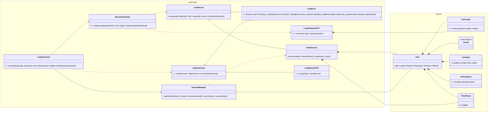
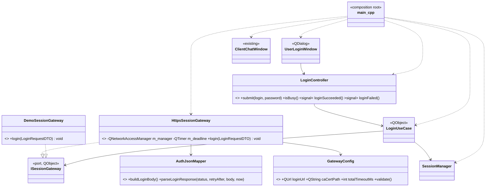
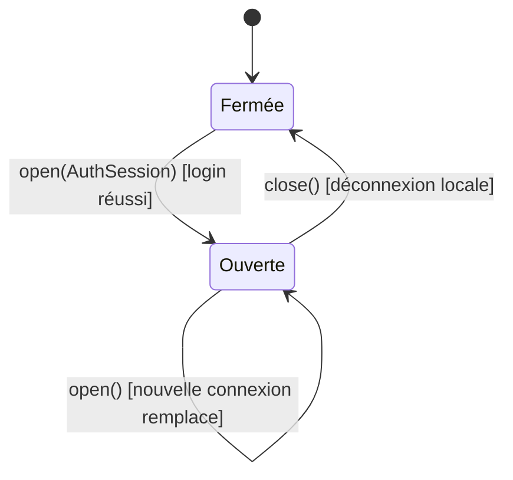
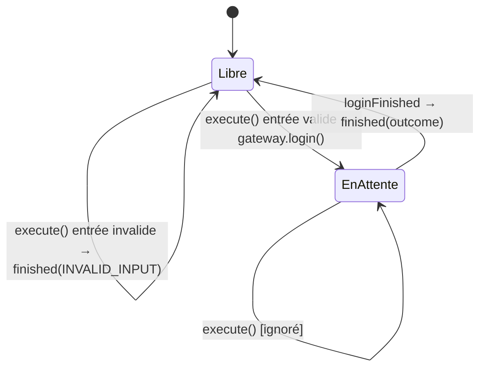

# UC1 — UML (v3)

> SECURECLOUD[SKELETON] · Client Qt · **v3 du 26/11/2026** · à lire avec `UC1_Connexion.md` (conception) et `ADR_UC1_Login_Client.md` (décisions).
> Remplace la v2 (09/11). **Les diagrammes Mermaid ci-dessous sont la source.** Les anciennes images PNG (port synchrone, thread de travail) ne sont plus valables et sont à régénérer si besoin.
> Changements : port et use case **asynchrones** (signaux), **plus de thread de travail**, Application **avec Qt Core**.

---

## 1. Classes

### 1.1 Domaine + Application

`LoginUseCase` ne connaît que le **port** `ISessionGateway` et `SessionManager`. Le domaine (sans Qt) est réutilisé tel quel. Les types d'Application marqués `QObject` portent les **signaux**.



### 1.2 Infrastructure + UI + racine de composition

Seul `main.cpp` voit toutes les couches. `HttpsSessionGateway` **implémente** le port défini dans l'Application (l'infrastructure dépend de l'Application, pas l'inverse). `DemoSessionGateway` est une seconde implémentation, **démo seulement**.



### 1.3 États de `SessionManager`



### 1.4 États de `LoginUseCase` (nouveau)



L'état repasse à **Libre avant** l'émission de `finished` : un slot peut relancer `execute()` aussitôt.

---

## 2. Séquence d'une connexion, par couches

Bleu = UI · vert = Application · orange = Infrastructure · violet = extérieur. **Un seul thread** (le thread UI) : pendant l'attente de la réponse, la boucle d'événements Qt continue de tourner, l'interface reste libre.

```mermaid
sequenceDiagram
autonumber
actor U as User
box LightBlue UI (Qt Widgets)
  participant W as UserLoginWindow
  participant C as LoginController
end
box PaleGreen APPLICATION (Qt Core)
  participant UC as LoginUseCase
  participant S as SessionManager
end
box Wheat INFRASTRUCTURE (Qt Network)
  participant G as HttpsSessionGateway
  participant M as AuthJsonMapper
end
box Lavender OUTSIDE
  participant API as API Gateway
end
U->>W: types login + password, clicks "Sign in"
W->>W: fields non-empty? set BUSY state, clear password field
W->>C: submit(login, password)
C->>UC: execute(rawLogin, password)
alt already busy
  UC-->>UC: ignored
else invalid input (password 1..256 bytes? UserLogin valid?)
  UC-->>C: signal finished(INVALID_INPUT) (NO network call)
else valid
  UC->>UC: m_busy = true
  UC->>G: login(LoginRequestDTO) via port (returns immediately)
  G->>API: POST /auth/login (HTTPS, TLS verified)
  Note over G,API: waiting: UI thread stays free; 20 s total timer running
  alt no HTTP status (DNS, TCP, TLS, timeout)
    G-->>UC: signal loginFinished(failure(SERVER_UNREACHABLE))
  else HTTP status received
    API-->>G: status + Retry-After + JSON body
    G->>M: parseLoginResponse(status, retryAfter, body, now)
    M-->>G: AuthResult (success or failure)
    G-->>UC: signal loginFinished(AuthResult)
  end
  UC->>UC: m_busy = false
  alt AuthResult.ok()
    UC->>S: open(session) (user.Online())
    UC-->>C: signal finished(LoginOutcome{login, role}) (never a token)
  else failure
    UC-->>C: signal finished(LoginOutcome{error, retryAfter}) (session untouched)
  end
end
C-->>W: signal loginSucceeded / loginFailed
W-->>U: main window, or error message (button re-enabled)
```

### Pseudo-code équivalent, balisé par couche

```text
[UI]     UserLoginWindow.onClick():
             si login vide ou mot de passe vide  -> FIN
             état « occupé » ; vider le champ mot de passe
             LoginController.submit(login, motDePasse)
[UI]     LoginController.submit():
             LoginUseCase.execute(login.toStdString(), motDePasse.toStdString())

[APP]    LoginUseCase.execute(loginBrut, motDePasse):
             si occupé                              -> ignorer
             si motDePasse vide ou > 256 octets     -> émettre finished(INVALID_INPUT)
             essayer login = UserLogin(loginBrut)   -> si invalide : émettre finished(INVALID_INPUT)
             occupé = vrai                          // AVANT l'appel
             passerelle.login({login, motDePasse})  // via le PORT, retourne tout de suite

[INFRA]  HttpsSessionGateway.login(requête):
             corps = AuthJsonMapper.buildLoginBody(requête)
             POST HTTPS (TLS vérifié, sans redirection) ; minuteur 20 s ; retourner
[INFRA]  à la réponse (ou au délai) :
             aucun statut HTTP ou délai -> émettre loginFinished(failure(SERVER_UNREACHABLE))
             sinon -> émettre loginFinished(AuthJsonMapper.parseLoginResponse(statut, Retry-After, corps, maintenant))

[APP]    LoginUseCase.onGatewayFinished(résultat):
             occupé = faux                          // AVANT d'émettre
             si résultat.ok(): sessions.open(résultat.session()) ; émettre finished(LoginOutcome{login, rôle})
             sinon:            émettre finished(LoginOutcome{erreur, retryAfter})

[UI]     LoginController.onUseCaseFinished(outcome):
             succès -> émettre loginSucceeded(login, rôle) ; échec -> émettre loginFailed(erreur, retryAfter)
[UI]     UserLoginWindow : succès -> fenêtre principale
                           échec  -> message selon AuthError ; réactiver le bouton
```
