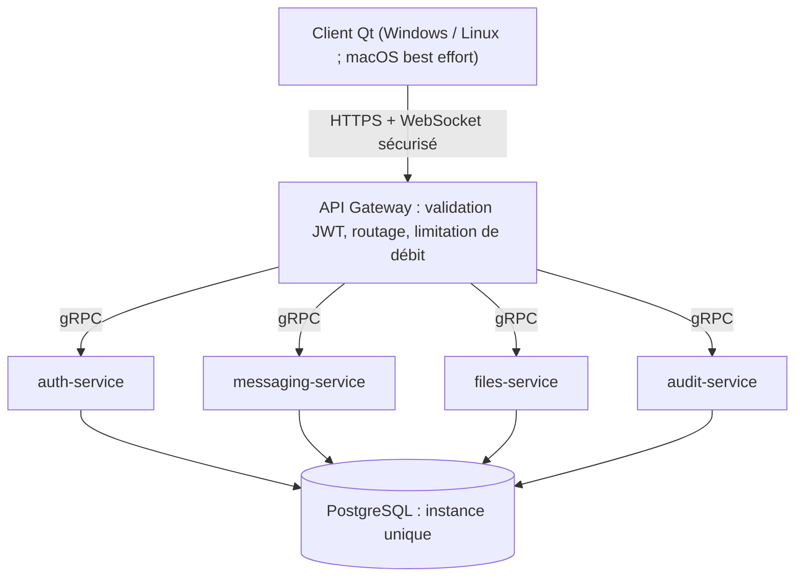

# Cahier des spécifications : SECURECLOUD[SKELETON]

> **Version** 2.0 · **Date** 04/11/2026 · **Statut** brouillon à relire · **Niveau** 1 (commun Client / Serveur)
> **Remplace** `specifications-securecloud-skeleton.md` v1 (et sa copie dans `General - Descript - V0.1.md`)
> **Documents liés** : [../school_vision/prototype_skeleton.md](../school_vision/prototype_skeleton.md) · [../school_vision/analyse_cahier_des_charges.md](../school_vision/analyse_cahier_des_charges.md) · [specifications_roadmap.md](specifications_roadmap.md) · [../decisions/ADR_global.md](../decisions/ADR_global.md)

**Mode d'emploi.** Ce document dit **ce qu'on construit**. Le *pourquoi* est dans l'analyse du cahier des charges ; le détail des *décisions* est dans le registre (colonne « ADR »). Un fait n'est écrit qu'ici : les documents du Client (niveau 2) y renvoient par identifiant (`F1.2`…) sans le recopier.

**Statuts.** SK (retenu), SK simplifié, RM (roadmap, voir `specifications_roadmap.md`), DS (écarté). **« Preuve »** : ce qui, à la soutenance, démontre que la spécification est satisfaite.

---

## 1. Architecture globale (A1 à A7)

> Formulation de référence : **« 4 services métier + 1 API Gateway + 1 infrastructure de données »**. Les liaisons précises entre services (par exemple Messaging vers Auth, Files, Audit) sont définies par les diagrammes de séquence et les contrats ; elles ne sont pas figées par ce schéma.

| ID | Exigence du cahier | Décision SKELETON | Statut | ADR | Preuve |
|---|---|---|---|---|---|
| A1 | Architecture microservices C++ avec API Gateway central | Gateway = **composant d'infrastructure distinct** des services métier. Services : auth, messaging, files, audit | SK | ARC-03 | `docker compose ps` : les 6 conteneurs sont sains |
| A2 | Pas de HTTP entre services ; named pipes, sockets de domaine, mémoire partagée | Client ↔ Gateway : HTTPS + WebSocket. Gateway ↔ services : **gRPC** uniquement. Named pipes et mémoire partagée écartés. Transport sous-jacent (TCP sur réseau Compose ou socket de domaine) à figer en semaine 3 | SK (reformulé) / DS (mécanismes natifs) | ARC-01, ARC-02 | Contrats `.proto` ; aucun service n'appelle l'API REST d'un autre |
| A3 | C++ pour les microservices | C++ pour services et Gateway ; outils périphériques libres | SK | CPP-01 | Build CMake des services |
| A4 | Qt pour l'interface | Qt 6 natif (versions et outils : documentation du Client) | SK | QT-01 | Build du Client |
| A5 | PostgreSQL | **Instance unique** ; ne stocke jamais de contenu en clair | SK | ARC-04, SEC-03 | Schéma ; revue des tables : aucun champ de contenu clair |
| A6 | `deploy-service` : microservice de déploiement | Non implémenté : son rôle est tenu par la pipeline CI/CD et Docker Compose | **RM** | ARC-06 | — |
| A7 | Temps réel et architecture distribuée | Ne pas mettre tous les services sur le chemin critique : **audit asynchrone**, autorisation par cache après validation du jeton. Comportement en cas de panne de chaque dépendance documenté et testé | SK | ARC-07 | Tests d'intégration « service arrêté » |

---

## 2. Module 1 : messagerie instantanée sécurisée

| ID | Exigence du cahier | Décision SKELETON | Statut | ADR | Preuve |
|---|---|---|---|---|---|
| F1.1 | Conversations 1-to-1 et groupes jusqu'à 100 participants | **1-to-1 en SK.** Groupes en RM ; le modèle les anticipe (base commune `Conversation`) ; un envoi vers un groupe est refusé avec l'erreur « fonction non disponible » | SK / RM | MSG-04 | Test UC-02 ; test du refus explicite |
| F1.2 | Chiffrement de bout en bout AES-256 | Contenu chiffré **côté émetteur**, serveur en routage aveugle. Primitives d'une bibliothèque éprouvée (libsodium) ; algorithme, mode et gestion des clés dans `Crypto.md`, **à rédiger avant** le développement du module | SK | SEC-02, SEC-03 | Test : le serveur ne peut pas déchiffrer ; revue cryptographique documentée |
| F1.3 | Temps réel par WebSockets sécurisés | WebSocket Client → Gateway ; gRPC (streaming) Gateway → messaging-service | SK | ARC-02 | Test d'intégration de livraison temps réel |
| F1.4 | Présence et notifications | Présence : `ONLINE` / `OFFLINE`, liée à l'état de la session ; `AWAY` en RM ; pas d'historique. Notifications **par règles explicites** : nouveau message, alerte, ajout à un groupe d'alerte ; désactivables. « Intelligentes » non retenu. Les mentions arriveront avec les groupes | SK simplifié | MSG-02 | Tests de transition de présence ; test de désactivation |
| F1.5 | Threads de conversation | Un thread est la **réponse à un message ciblé** ; pas d'arborescence. Impact : un message pourra référencer un message parent (à instruire dans le domaine) | SK simplifié / RM | MSG-01 | Test d'envoi d'une réponse |
| F1.6 | Recherche dans l'historique (index chiffré local) | Recherche texte simple sur les messages déchiffrés **côté Client**. Le serveur n'offre aucun moteur de recherche | SK | SEC-04 | Test de recherche locale ; absence d'endpoint de recherche |
| F1.7 | Modèle de threading scalable à 10 000 msg/s | Benchmark reproductible défini (clients simulés, taille moyenne, durée, latence P95/P99, taux d'erreur). On publie : « objectif cible 10 000 msg/s ; valeur mesurée : X msg/s » | SK (méthode) / **DS** (valeur) | PERF-01 | Rapport de benchmark |
| F1.8 | Priorité d'urgence médicale | Trois niveaux `NORMAL` / `HIGH` / `CRITICAL`, alerte visuelle et sonore sur `CRITICAL`. Priorité **logique et d'affichage**, pas une garantie de livraison | SK simplifié | MSG-03 | Test : un message `CRITICAL` est traité avant les autres dans la file |
| F1.9 | Diffusion d'alerte globale avec accusé de réception | Diffusion à un **groupe d'alerte** (distinct d'un groupe de discussion) ; l'« accusé forcé » devient un **suivi d'acquittement** (acquitté / non acquitté) visible de l'émetteur. Groupes d'alerte préchargés en SKELETON | SK | MSG-05 | Test du cycle de vie d'une alerte |
| F1.10 | *(nouveau)* Statuts de livraison d'un message | Statuts `DRAFTED`, `BUFFERED`, `SENDING`, `SENT`, `DELIVERED`, `READ`, `UNDELIVERED`. Sens exact de `SENT` / `DELIVERED` et idempotence : **à décider** | SK, à décider | MSG-06 | Table de transitions testée |
| F1.11 | *(nouveau)* Création d'une conversation | Une conversation directe naît au premier message ; l'identifiant est généré par le Client | SK, proposé | MSG-07 | Test : le premier message crée la conversation sans doublon |

**Pourquoi les groupes sont reportés.** Un message de groupe doit être distribué à N destinataires dont certains hors ligne (une file par destinataire). Les permissions varient dans le temps (un membre retiré voit-il l'historique ?). Avec le chiffrement de bout en bout, chaque changement de membre oblige à renouveler et redistribuer les clés de groupe, problème connu des protocoles de messagerie. Chaque scénario double ou triple le nombre de cas à tester.

---

## 3. Module 2 : partage de fichiers sécurisé

| ID | Exigence du cahier | Décision SKELETON | Statut | ADR | Preuve |
|---|---|---|---|---|---|
| F2.1 | Serveur HTTP/HTTPS C++ natif | Interface HTTPS **externe** seulement, via une bibliothèque C++ éprouvée (pas de parsing HTTP maison). Gateway ↔ files-service en gRPC | SK | ARC-01 | Test d'intégration d'upload |
| F2.2 | Chiffrement streaming avec chunking | Protocole minimal : `TransferId`, `ChunkId`, `TotalChunks`, `Payload`, `IntegrityTag`. Reprise = relance du bloc en échec ; pas de reprise avancée | SK | FILE-03 | Test avec un bloc perdu |
| F2.3 | Compression zlib | Compression **avant** chiffrement, lorsque applicable | SK | FILE-04 | Test aller-retour |
| F2.4 | Système de fichiers virtuel chiffré | Pas de VFS maison : stockage chiffré **fichier par fichier** avec un index chiffré simple | SK simplifié | FILE-05 | Test de stockage et relecture |
| F2.5 | Déduplication au niveau des blocs | Incompatible avec le chiffrement de bout en bout. Hors périmètre | **DS** | FILE-02 | — |
| F2.6 | Upload de 500 Mo en moins de 3 minutes | **Deux scénarios séparés, jamais simultanés** : (1) réseau de démonstration normal, 500 Mo < 3 min ; (2) lien de 256 kbps simulé, mode dégradé avec reprise, sans contrainte de temps | SK | PERF-03 | Mesure chronométrée ; test sous limitation de débit |
| F2.7 | Sauvegarde terrain sans Internet | Client → stockage local chiffré → file d'attente → synchronisation au retour du réseau. Testé par coupure simulée, pas 48 h en conditions réelles | SK simplifié | FILE-01 | Test de coupure et reprise |
| F2.8 | *(nouveau)* Nom de fichier d'une pièce jointe | En clair pour le serveur ou inclus dans le contenu opaque : **à décider** (recommandation : dans le contenu opaque) | À décider | FILE-06 | — |

---

## 4. Module 3 : authentification et autorisation

**Endpoints** (REST externe, relayés en gRPC) :

| Endpoint | Rôle | Statut côté serveur | Côté Client |
|---|---|---|---|
| `POST /auth/login` | Authentification initiale | SK | **Première tranche livrée** (E2E vendredi 06/11/2026) |
| `POST /auth/refresh` | Renouvellement du jeton | SK | Après la première tranche |
| `GET /auth/validate` | Validation rapide d'un jeton | SK | Jamais appelé par le Client (Gateway ↔ auth seulement) |
| `POST /auth/permissions` | Droits pour une action | SK | — |
| `POST /auth/revoke` | Révocation | SK | Après la première tranche |

Le contrat détaillé de `login` est dans `contracts/` (lot suivant).

| ID | Exigence du cahier | Décision SKELETON | Statut | ADR | Preuve |
|---|---|---|---|---|---|
| F3.1 | Login avec vérification multi-facteurs | Hachage par une bibliothèque standard (argon2 ou bcrypt). MFA : **TOTP** si le temps le permet, sinon MFA simulé ; dans les deux cas, mécanisme documenté | SK | AUTH-02 | Scénarios E2E de login |
| F3.2 | Refresh JWT et validation continue | Bibliothèque JWT standard (jwt-cpp). Modèle : jeton d'accès court + jeton de rafraîchissement + version de session côté Auth | SK | AUTH-01 | Test de refresh |
| F3.3 | Validation rapide de jeton | Latence de `/auth/validate` mesurée en **P95/P99** (cible < 45 ms, ajustée après la première mesure) | SK | PERF-02 | Mesure sur le scénario de benchmark |
| F3.4 | Permissions granulaires | **RBAC simple** à trois rôles fixes ; matrice complète User/Role/Permission/Resource/Action/Scope en RM. Permissions portées par le rôle, jamais un nom de rôle en dur | SK simplifié | AUTH-03 | Test par rôle |
| F3.5 | Révocation immédiate | « Immédiat » = aucun nouveau traitement authentifié accepté après propagation de la révocation. Testé fonctionnellement ; pas de garantie chiffrée de latence < 1 s | SK | AUTH-05 | Test : le jeton ne fonctionne plus après révocation |
| F3.6 | Annuaire de 45 000 utilisateurs | Jeu de données simulé de quelques centaines. 45 000 reste un objectif d'architecture cible | **DS** (volume) / RM (architecture) | AUTH-04 | — |
| F3.7 | *(nouveau)* Normalisation du login | Login normalisé en **minuscules**, espaces de bord retirés, espaces internes refusés, jeu de caractères limité ; le serveur renormalise de son côté | SK | AUTH-06 | Tests de normalisation côté Client et serveur |
| F3.8 | *(nouveau)* Résistance à la force brute | Limitation de débit à la Gateway **avant** l'appel à Auth (par login et par IP), réponse `429` avec `Retry-After`. Seuil de départ proposé : 5 échecs en 5 minutes | SK | AUTH-07 | Scénario de test de blocage |

Rôles : concepts métier **utilisateur, coordinateur, administrateur** ; valeurs d'énumération dans le code et sur le fil `STD_USER`, `COORD`, `ADMIN` (AUTH-03).

---

## 5. Module 4 : interface utilisateur Qt

| ID | Exigence du cahier | Décision SKELETON | Statut | ADR | Preuve |
|---|---|---|---|---|---|
| F4.1 | Interface native Windows, Linux, macOS | Build et tests validés sur **Windows et Linux**. macOS en *best effort*, non garanti | SK / RM | QT-01 | Build sur deux OS |
| F4.2 | Démarrage < 2 s | Mesure informelle (chronométrage ou script simple), pas de benchmark automatisé en CI | SK | QT-02 | Mesure notée dans le dossier de tests |
| F4.3 | Mémoire < 50 Mo | Profilage ponctuel (gestionnaire de tâches, outils Linux) | SK | QT-02 | Mesure notée |
| F4.4 | Résilience (45 °C, poussière, 256 kbps) | Seul le **réseau dégradé** (256 kbps simulé par limitation de débit) est testé. Les conditions physiques sont **non démontrables** et documentées comme telles | SK partiel / **DS** | QT-03 | Test sous limitation de débit |

---

## 6. Module 5 : déploiement et infrastructure

| ID | Exigence du cahier | Décision SKELETON | Statut | ADR | Preuve |
|---|---|---|---|---|---|
| F5.1 | Pipeline CI/CD complète | Sur GitHub (GitHub Actions). **Pull request** : build, tests unitaires et d'intégration, package. **Branche principale** : idem + déploiement sur environnement de démonstration + contrôle de santé. Pas de déploiement automatique en « production » à chaque commit | SK | CI-01 | Pipeline verte |
| F5.2 | `git push` → 5 minutes → production | Reformulé : push sur la branche de déploiement → pipeline complète → **environnement de démonstration** opérationnel en ≤ 5 minutes | SK | CI-02 | Mesure de la durée |
| F5.3 | Orchestration Docker Compose | Services : `gateway`, `auth-service`, `messaging-service`, `files-service`, `audit-service`, `postgresql`. PostgreSQL en instance unique, mono-nœud | SK | ARC-03, ARC-05 | `docker compose up` |
| F5.4 | Logs d'audit chiffrés et inaltérables | Événements de sécurité et d'administration (`USER_LOGIN`, `TOKEN_REVOKED`, `FILE_UPLOADED`, `PERMISSION_CHANGED`…), **jamais** de contenu clair, mot de passe, jeton ni clé privée. Asynchrone, hors chemin critique. Journal en ajout seul, chiffré au repos ; **inaltérabilité cryptographique en RM** | SK | AUD-01 | Test : aucun secret dans un événement |
| F5.5 | *(nouveau)* Sécurité de la chaîne | Analyse statique, scan des images, secrets hors dépôt, retour arrière documenté | SK simplifié | CI-01 | Étapes présentes dans la pipeline |

---

## 7. Exigences non fonctionnelles

| ID | Exigence du cahier | Décision SKELETON | Statut | ADR |
|---|---|---|---|---|
| N1 | 10 000 messages/s | Méthode de mesure définie et exécutée ; valeur mesurée publiée telle quelle | SK (méthode) / **DS** (valeur) | PERF-01 |
| N2 | Temps de réponse < 100 ms | Latence Client A → réception Client B, en **P95/P99**, dans les conditions nominales du benchmark | SK | PERF-02 |
| N3 | Disponibilité 99,9 %, « zéro tolérance à la panne » | « Zéro panne » supprimé. SKELETON : pas de point unique évident dans l'architecture applicative, redémarrage automatique d'un conteneur après un crash simple. 99,9 % = **objectif d'architecture cible**, non mesuré | SK reformulé | OPS-01 |
| N4 | Scalabilité | À définir : conception des services sans état local (hors PostgreSQL), démontrée par plusieurs instances d'au moins un service sans état | À décider | OPS-02 |
| N5 | « Inviolable », résistance aux attaques étatiques | Exigence **remplacée** par un modèle de menace et des propriétés vérifiables ; `threat_model.md` à rédiger | SK (modèle) / **DS** (propriété absolue) | SEC-01 |
| N6 | Audit de sécurité par un tiers | Non réalisé. Revue cryptographique interne documentée ; mention explicite : « audit externe professionnel non réalisé dans le cadre du projet » | **DS** | TEST-02 |

---

## 8. Stratégie de tests

Principe directeur conservé : **« Microservices = complexité × 5 = tests × 10 »**.

**Couverture « 100 % »** (TEST-01) : 100 % des **cas d'usage retenus pour SKELETON** sont couverts par au moins un test d'intégration. La couverture de lignes (outil de coverage C++) est suivie à titre indicatif, sans seuil contraignant.

### 8.1 Les cinq scénarios de crise

| # | Scénario du cahier | Version SKELETON | Statut |
|---|---|---|---|
| 1 | Login sur liaison satellite instable | Lien de 256 kbps simulé par limitation de débit local | SK |
| 2 | Évacuation d'urgence : révocation d'accès | Test fonctionnel : le jeton ne fonctionne plus, sans garantie chiffrée de latence | SK |
| 3 | Scanner d'urgence : 500 Mo en moins de 3 minutes | Sur réseau de démonstration normal uniquement | SK |
| 4 | Isolement réseau total : sauvegarde terrain | Coupure simulée en développement | SK simplifié |
| 5 | Urgence chirurgicale : routage < 50 ms sous 10 000 msg/s | Routage prioritaire démontré fonctionnellement ; **pas sous charge réelle** | SK (principe) / **DS** (charge) |

### 8.2 Points de défaillance (grille FMEA)

La grille du cahier (Client : plantages et fuites mémoire ; Gateway : erreurs de routage et de limitation de débit ; services : perte de message, échec d'authentification, corruption de fichier, perte de journal ; base : corruption, perte de connexion) sert à **prioriser les tests d'intégration**. Les stratégies de résilience associées sont classées : gestion d'erreurs de base et pointeurs intelligents C++ = SK ; réplication PostgreSQL et routage redondant = RM.

---

## 9. Livrables

Voir `../school_vision/prototype_skeleton.md` §5 (liste recalibrée à l'échelle SKELETON). Les livrables non retenus (plateforme opérationnelle pour MSF, formation) sont DS.

---

## Journal des changements

| Version | Date | Changement |
|---|---|---|
| 2.0 | 04/11/2026 | Refonte. **Corrige** : « 5 microservices » devient « 4 services métier + Gateway + PostgreSQL » (A1, F5.3) ; `deploy-service` classé **RM** (il était DS dans la spec v1 et « ?? » dans une copie) ; `AWAY` classé **RM** (F1.4, conforme au domaine v0.2) ; rôles : concepts et valeurs d'énumération distingués (F3) ; login normalisé en minuscules (F3.7) ; « mention » retirée des notifications SK ; inaltérabilité du journal d'audit passée en RM ; ajout de F1.10, F1.11, F2.8, F3.7, F3.8, F5.5, A7 ; ajout de la colonne « Preuve » ; suppression du tableau de synthèse (il dupliquait les statuts) |
