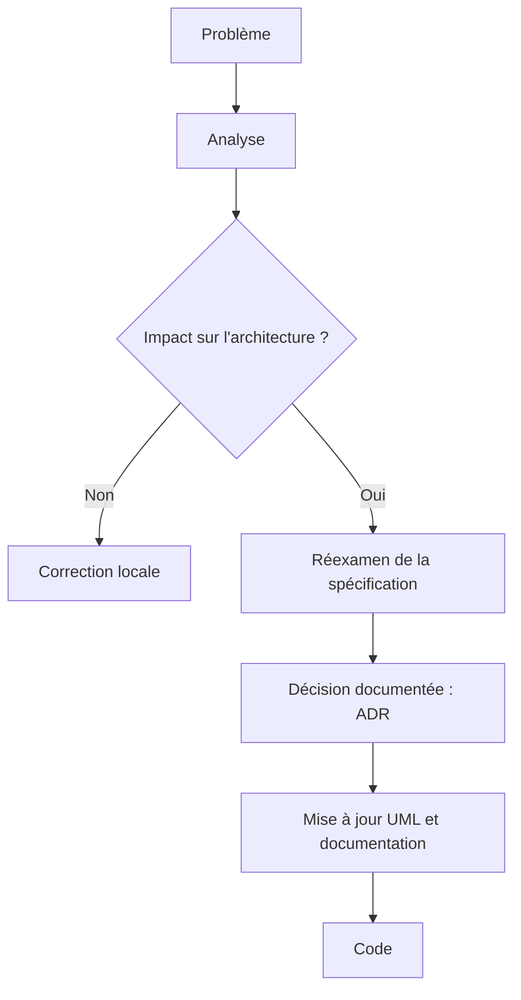

# SecureCloud : le projet d'école et le référentiel RNCP

> **Version** 1.0 · **Date** 04/11/2026 · **Statut** brouillon à relire · **Niveau** 1 (commun Client / Serveur)
> **Documents liés** : [prototype_skeleton.md](prototype_skeleton.md) · [vision_produit.md](vision_produit.md) · [analyse_cahier_des_charges.md](analyse_cahier_des_charges.md)

Ce document répond à la question : **pourquoi ce projet existe-t-il, dans quel cadre est-il évalué, et comment l'équipe travaille-t-elle ?**
Il ne décrit ni le produit (voir `vision_produit.md`) ni l'architecture.

---

## 1. Cadre

| Élément | Valeur |
|---|---|
| Formation | Bachelor IT, 3e année (B3), La Plateforme, Marseille |
| Référentiel | Titre professionnel « Concepteur développeur d'applications » (RNCP 37873) |
| Durée | **six semaines effectives**, fixées par l'école |
| Équipe | trois étudiants : Abdelrahmane Amiri, Sana Bouchal, Jean-Christophe Gerace |
| Client | fictif : Médecins Sans Frontières (MSF). Le rôle du client est tenu par l'encadrement pédagogique |
| Évaluation | présentation avec support + revue de code |

## 2. Objectifs pédagogiques

À l'issue du projet, l'équipe doit être capable de :

1. **Développer une application sécurisée.**
2. **Concevoir et développer une application sécurisée organisée en couches.**
3. **Préparer le déploiement d'une application sécurisée.**

Ce sont **les attendus réels** du projet. Toute fonctionnalité du cahier des charges qui ne sert pas l'un de ces trois objectifs, ou qui dépasse ce que six semaines permettent de démontrer, est reportée ou écartée de façon documentée (voir `prototype_skeleton.md`).

## 3. Compétences visées et où elles sont démontrées

| Activité type | Compétence | Où la preuve se trouve |
|---|---|---|
| **1. Développer une application sécurisée** | Installer et configurer son environnement de travail | `client/docs/technics/` (Qt, CMake, MSYS2), Docker Compose, scripts de build |
| | Développer des interfaces utilisateur | Client Qt (`LoginWindow`, fenêtres de messagerie et d'alertes) |
| | Développer des composants métier | Domaine du Client (C++ pur) ; microservices C++ |
| | Contribuer à la gestion d'un projet informatique | Cette documentation, registre des décisions, workflow Git, revues croisées |
| **2. Concevoir une application en couches** | Analyser les besoins et maquetter | Cas d'utilisation, maquettes d'écrans |
| | Définir l'architecture logicielle | Architecture globale (Gateway + services) et architecture en couches du Client |
| | Concevoir une base de données relationnelle | Schéma PostgreSQL (serveur) |
| | Développer des composants d'accès aux données SQL **et NoSQL** | Repositories : SQLite (Client), PostgreSQL (serveur). **Voir l'alerte ci-dessous** |
| **3. Préparer le déploiement** | Préparer et exécuter les plans de tests | Stratégie de tests, tests unitaires et d'intégration, E2E |
| | Préparer et documenter le déploiement | Docker Compose, procédures de déploiement |
| | Contribuer à la mise en production (DevOps) | Pipeline CI/CD (build, test, package, deploy, verify) |
| **Transversales** | Communiquer en français et en anglais | Documentation en français, résumé anglais dans le README |
| | Démarche de résolution de problème | Analyse critique du cahier des charges, registre des décisions |
| | Apprendre en continu | Guides pédagogiques (par exemple `UC1_Connexion.md`) |

## 4. Évaluation et soutenance

Le support de présentation contient :

- l'organisation de l'équipe ;
- les problèmes rencontrés et les solutions apportées ;
- la démonstration du programme ;
- l'architecture technique ;
- la stratégie de tests et ses résultats.

La revue de code a lieu avec l'équipe pédagogique. Le dépôt GitHub est public : il sert aussi de vitrine auprès des recruteurs, d'où l'exigence d'une documentation claire, professionnelle et traçable.

## 5. Démarche DevOps

- Intégration continue : code mis en commun sur un dépôt distant, build et tests automatiques à chaque *pull request*.
- Pipeline en cinq étapes : **Build → Test → Package → Deploy → Verify**.
- Environnements de test et de démonstration conteneurisés (Docker). Un `docker compose up` démarre la pile complète.
- Contrôle de la qualité du code et analyse statique intégrés à la pipeline.

Les décisions de détail (déclencheurs, environnements, délai de 5 minutes) sont dans le registre des décisions (CI-01, CI-02).

## 6. Équipe et organisation

Trois domaines de référence. Chacun pilote son domaine mais **chacun doit comprendre et savoir tester les trois**.

| Référent | Périmètre |
|---|---|
| Backend et architecture | Contrats inter-services, Auth, API Gateway, modèle d'erreurs, gRPC, PostgreSQL |
| Messaging et sécurité | Messaging, Files, modèle cryptographique, gestion des clés, sécurité applicative |
| Client et DevOps | Client Qt, stockage local, Docker, CI/CD, intégration, packaging |

Règles :

- Aucun service n'est la propriété exclusive d'un membre.
- Chacun présente et explique l'avancement de son travail.
- **Les tests sont écrits, autant que possible, par quelqu'un qui n'a pas écrit le code testé.**
- Chaque proposition est testée en théorie (expérience de pensée) avant d'être commencée.

## 7. Méthode de travail

### 7.1 La chaîne

> **Exigence → analyse → décision → spécification → implémentation → test → preuve**

et non : idée → code → problème → bricolage → nouvelle architecture.

### 7.2 Statut d'une proposition

| Statut | Sens |
|---|---|
| Conforme | Respecte directement le cahier des charges |
| Compatible | Non demandée, mais ne contredit rien |
| À arbitrer | Plusieurs solutions, décision d'équipe nécessaire |
| Contradictoire | En conflit avec une exigence existante |
| Non démontrable | L'exigence existe mais on ne sait pas (encore) la prouver |
| Hors périmètre | Intéressante, mais détournerait le temps disponible |

Ce classement sert à éviter le *scope creep* (extension non contrôlée du périmètre) et la divergence (écart non corrigé entre documents et code).

### 7.3 Que faire quand un problème apparaît

Règle : **une divergence entre le code et un document se corrige d'abord dans le document.**

## 8. Hiérarchie et organisation de la documentation

### 8.1 Cinq niveaux de référence

| Niveau | Rôle |
|---|---|
| 1. Cahier des charges | Référentiel contractuel : objectifs, périmètre, contraintes, critères d'acceptation |
| 2. Vision produit | Le « pourquoi » : utilisateurs, contexte, scénario MSF |
| 3. Étapes de production | Cas d'utilisation, séquences, architecture, modèles de données, contrats d'API, stratégie de chiffrement et de tests, CI/CD |
| 4. Implémentation | Le code découle des spécifications validées |
| 5. Validation | Tests, mesures, démonstrations, comparaison aux critères d'acceptation |

### 8.2 Deux niveaux de documents

> **Règle : un fait s'écrit à un seul endroit.** Le niveau 2 (Client) précise le niveau 1 ou y renvoie ; il ne le redéfinit jamais.

| Niveau | Contenu | Emplacement (monorepo) |
|---|---|---|
| 1. Commun | Vision école, spécifications, décisions, domaine, architecture globale, contrats Client-Serveur | `docs/` |
| 2. Client | Spécifications Client, bibliothèque du domaine Client, architecture Client, cas d'utilisation détaillés, installation | `client/docs/` |

| Dossier du niveau 1 | Rôle | État |
|---|---|---|
| `school_vision/` | Pourquoi et dans quel cadre | **ce lot** |
| `specifications/` | Ce qu'on construit | **ce lot** |
| `decisions/` | Ce qu'on a décidé | **ce lot** |
| `domain/` | De quoi parle SecureCloud | lot suivant (domaine v0.2 à migrer) |
| `architecture/` | Comment c'est construit (globalement) | lot suivant (**manque aujourd'hui**) |
| `contracts/` | Contrats Client ↔ Gateway ↔ services | lot suivant (le contrat d'authentification y sera déplacé) |
| `use_cases/` | Cas d'utilisation | lot suivant |

---

## Journal des changements

| Version | Date | Changement |
|---|---|---|
| 1.0 | 04/11/2026 | Première rédaction « au propre » ; remplace `General - Descript - V0.1.md` (partie contexte) et la première partie de la Vision école |
